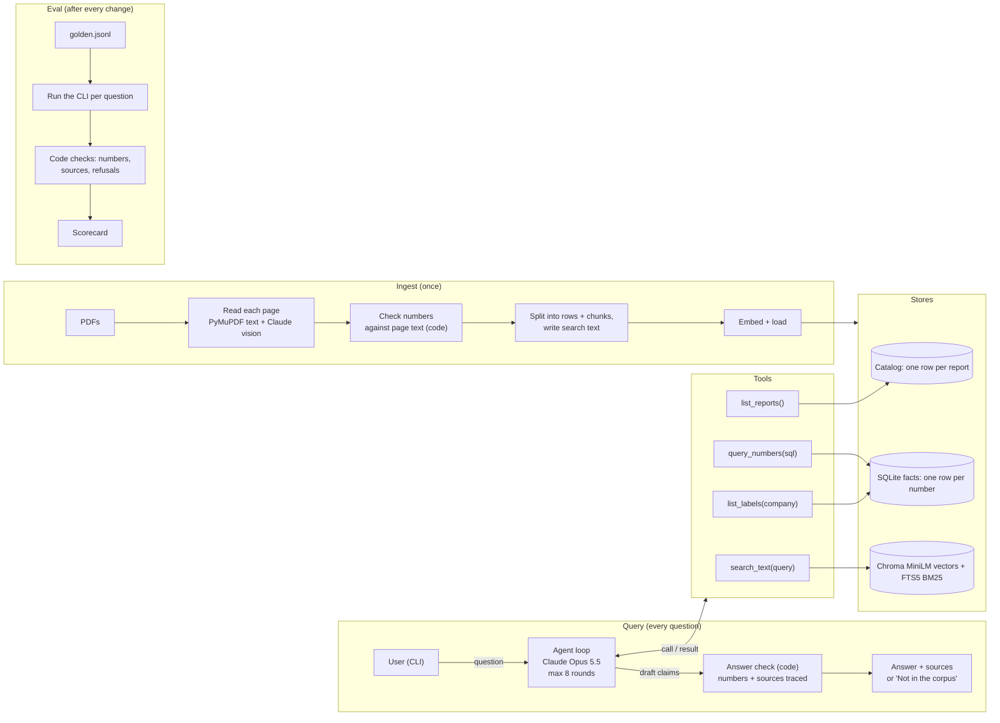

# Grounded Financial Analyst

A command-line analyst that answers questions over a folder of broker research PDFs. Every claim cites the report it came from, and when the reports don't contain the answer it says so instead of guessing.

- **Design:** [DESIGN.md](DESIGN.md). The diagram is also an [Excalidraw file](design/system-design.excalidraw) ([open it in Excalidraw](https://excalidraw.com/#json=NVlGfcGPt06jvL7l9KLEB,ayQ9MlwI-SWJxA14YqS2Zg)).
- **Spoken walkthrough, with one question traced end to end:** [design/WALKTHROUGH.md](design/WALKTHROUGH.md)
- **Build plan and the check for each piece:** [PLAN.md](PLAN.md)

## How it works



Two ideas carry the design:

1. **Numbers and text are stored differently.** Every table cell becomes a row in a SQL table, so a number is looked up exactly. Narrative goes into a vector index plus a keyword index, searched by meaning and by exact words.
2. **The model works in a loop, and code checks its answer.** The model picks a tool, reads the result, and tries another way if something is missing. Before anything is shown, code confirms every number and every source came from a tool result.

## Run it

Needs Python 3.13, [uv](https://docs.astral.sh/uv/) and an Anthropic API key. The PDFs are not in this repository because they are the broker's copyrighted reports; put them in `docs/`.

```bash
uv venv --python 3.13 .venv
uv pip install --python .venv/bin/python -r requirements.txt
cp .env.example .env                                   # then paste your key into .env
.venv/bin/python -m analyst ingest docs/               # once; cached, so re-runs are free
.venv/bin/python -m analyst ask "What rating and target price does the broker assign to NALCO?" --debug
.venv/bin/python -m analyst eval --tier samples        # the six sample questions
.venv/bin/python -m pytest -q
```

Every command prints what it spent. A budget cap (`ANALYST_BUDGET_USD`, default 25) stops paid calls when it is reached.

## Review Q&A

**Why not put everything in a vector database?**
Vector search matches meaning, and a number has no meaning to match on. Exact cells, questions that span several columns, and rankings need an exact lookup, so numbers go in SQL and only narrative goes through search.

**How does the model know what SQL to write?**
Its instructions carry the table's columns, the company names with their aliases, and the standard metric names. For any other row it calls `list_labels` first, and a query that returns nothing comes back with the valid names so it can retry.

**Is model-written SQL safe?**
It runs on a read-only connection, as a single `SELECT`, capped at 200 rows.

**How do you make sure every claim is cited?**
The model submits its answer as claims with sources. Code keeps a claim only if its source is a document a tool actually returned in that run, and prints the citation from that data.

**How do you stop it inventing numbers?**
Every number in a claim must trace to a number in a tool result, allowing for rounding and million/billion scaling. Derived numbers have to be computed in SQL so they appear in a result; anything untraceable is sent back once, then dropped.

**When does it refuse?**
When the company is not in the catalog, when the tools find nothing after retries, or when no claim survives the check. A half-answerable question gets the supported half plus a line saying what is missing.

**How does the loop know to retry, and when to stop?**
After each tool result the model sees the question and everything returned so far, and either calls another tool or submits. Code adds a hint on empty results, and the loop stops after 8 rounds.

**Why a vision model for ingestion?**
PDF text extraction loses which number sits under which column and gets nothing from charts. Reading the page as an image keeps the layout.

**How do you know the tables were read correctly?**
Each value must be printed on its page, each row must have one value per column, and four quarters must add up to the full year. Pages that fail are retried, then escalated to a stronger model, then listed as failed.

**Some reports print forecasts with no "E". How is that handled?**
The forecast flag is set in code from each report's reported quarter, never from the table header.

**How are mixed units handled?**
Each number keeps its printed unit, and money totals also get a column converted to INR millions in code. Rankings and comparisons use that column.

**How do sector questions work?**
Membership is the broker's own sector label in the catalog. The answer opens with which reports carry the label and mentions related companies filed under a different one.

**What if a report contradicts itself?**
The model is told to return every value it finds for the same thing and say that they differ, with both citations.

**Why Chroma, MiniLM and SQLite FTS5?**
All three run locally with no server, which fits a corpus of this size. Keyword search catches exact terms such as "EBITDA/MT"; vectors catch paraphrases; the two rankings are merged.

**Why no LangChain?**
It would wrap the same Claude, Chroma and SQLite calls. Owning the small loop is what lets code verify every citation against raw tool results.

**Why not fine-tune on the sample questions?**
Knowledge baked into weights cannot be cited or reliably refused, and six questions are a test set, not training data.

**How would this scale to thousands of reports?**
The stores and tools stay the same. The catalog moves out of the prompt into a lookup tool, Chroma is swapped for a hosted vector store, and ingestion is already per page and parallel.

**How was it evaluated?**
44 questions with expected numbers, expected source documents and expected refusals, scored by code. The expected values were checked against the PDF text, and 15 questions were held out from tuning.

## Limits

- A general-knowledge sentence attached to a real citation can pass the check; the refusal questions in the eval are what catch it.
- A value misread into a neighbouring cell is only caught where a total exists to cross-check it.
- Chart values are described, not measured, and are marked approximate.
- A table that continues across two pages is read as two tables.

## Status

Build in progress. Results (eval scorecard, cost per question, chosen page-reading model) are added here when the build finishes.
