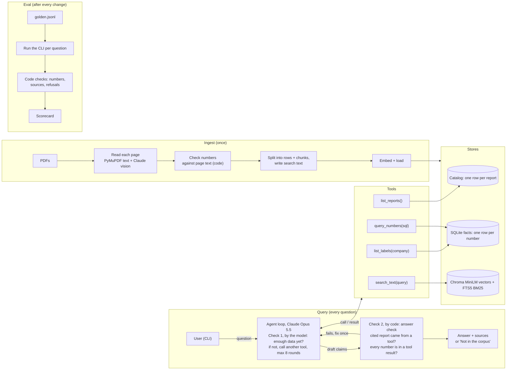

# Grounded Financial Analyst

A command-line analyst that answers questions over a folder of broker research PDFs. Every claim cites the report it came from, and when the reports don't contain the answer it says so instead of guessing.

- **Design in depth:** [DESIGN.md](DESIGN.md)
- **Build plan and the check for each piece:** [PLAN.md](PLAN.md)

## System design


[Open the diagram in Excalidraw](https://excalidraw.com/#json=N0_f68sYSKmxPD8SnL8Hr,MJ_5MJJG-F3U2QXaCooLZg) (use a private window if you already have a drawing open there), or load [design/system-design.excalidraw](design/system-design.excalidraw).

<details>
<summary>The same diagram as text (Mermaid)</summary>



</details>

Two ideas carry the design:

1. **Numbers and text are stored differently.** Every table cell becomes a row in a SQL table, so a number is looked up exactly. Narrative goes into a vector index plus a keyword index, searched by meaning and by exact words.
2. **The model works in a loop, and code checks its answer.** The model picks a tool, reads the result, and tries another way if something is missing. Before anything is shown, code confirms every number and every source came from a tool result.

## The two checks

They run at different moments and answer different questions.

| | Check 1: is there enough data? | Check 2: does the draft match the data? |
|---|---|---|
| When | After every tool result, inside the loop | Once, on the finished draft, before anything is shown |
| Done by | The model | Plain code |
| On failure | Call another tool, up to 8 rounds | Back to the model once with the reason, then the statement is dropped |

Check 2 is possible because the draft is not free text. The model submits a list of statements, each with the reports it cites, and code compares each one to what the tools returned in that run:

1. **Sources.** Every cited report must be one a tool actually returned.
2. **Numbers.** Every number must appear in a tool result. Rounding and million/billion scaling are allowed, and anything calculated has to come from a SQL query so that it shows up in a result too.

If no statement survives, the answer is "Not in the corpus".

Example: the tools return 9,384 and 8,788, and the draft adds "up 16.5% YoY". No tool returned 16.5, so that statement goes back to the model, which queries the growth figure and resubmits.

Check 1 makes sure the right data was found. Check 2 makes sure nothing was written that the data does not support, which matters because the brief counts an uncited claim as wrong even when the number is right.

## Walkthrough

<details>
<summary><b>The one-minute version</b></summary>

> "It's a command-line analyst over 17 broker reports. There are three parts: ingest, query, and eval.
>
> Ingest runs once. Each page is read by a vision model and checked by code. Every table cell becomes a row in a SQL table; narrative goes into a vector and keyword index.
>
> At query time the model works in a loop with four tools. It looks numbers up with SQL, finds explanations with search, and can try again when something is missing. Before the answer is shown, code confirms every number and every source came from a tool result. If nothing supports an answer, it says the corpus doesn't contain it.
>
> The eval is 44 questions scored by code on numbers, sources and refusals."

</details>

<details>
<summary><b>The full spoken walkthrough: ingest, query, eval</b></summary>

**Ingest**

> "A PDF only stores characters at positions, so plain text extraction loses which number is in which column, and charts come out as nothing. So each page goes to a vision model, which returns the page as structured data: text blocks, tables as columns and rows, and a description of each chart.
>
> I don't trust that output until code has checked it. Every number has to be literally printed on that page. Every row has to have one value per column. Where a table has four quarters and a full year, the quarters have to add up. A page that fails is retried, then escalated to a stronger model.
>
> Then the data is split two ways. Table cells go into SQLite as one row per number, with the company, the row label, the period, the unit, whether it's an actual or a forecast, and the document and page. Narrative is cut into chunks by section, embedded with MiniLM into Chroma, and indexed for keyword search. Tables and charts get a one-line description so search can find them."

**Query**

> "A question goes to the agent loop. The model has four tools: list the reports, list the row labels a report has, run a SQL query over the numbers, and search the text.
>
> There are two checks. The first is the model's: after every tool result it sees the question and everything returned so far, and decides whether it has enough. If a query comes back empty, or it asked about three companies and got two, it tries another way. That is capped at eight rounds.
>
> The second check is code. The model doesn't write the final text freely; it submits statements, each with the reports it cites. Code confirms each cited report is one a tool actually returned, and that every number appears in a tool result. Anything that fails goes back once, then is dropped. If nothing survives, the answer is 'not in the corpus'."

**Eval**

> "I have 44 questions: the six samples plus lookups, derivations, rankings with unit traps, sector questions, and questions that should be refused. Each has the numbers the answer must contain and the documents it must cite. Code scores them. I verified the expected values against the PDF text, and held 15 questions back from tuning."

</details>

<details>
<summary><b>One question, followed through every box</b></summary>

**Question:** "Why did Escorts Kubota's gross margin decline in 1QFY27 despite 28% revenue growth, and what is the margin outlook?"

It needs a number from a table and a reason from the commentary, so it touches both stores.

**Before the question: how the data got there**

| Source in the PDF | What ingest stored |
|---|---|
| The key performance table's gross margin row | A `facts` row: Escorts Kubota, gross margin, 1QFY27, 27.2, %, actual, with document and page |
| The quarterly table's sales row and its growth | `facts` rows: revenue 31,789 INR m and revenue growth 28.0% |
| The paragraph on raw-material costs | A text chunk in Chroma and the keyword index, tagged Escorts Kubota |

**The loop (check 1 after each result)**

| Round | The model does | What comes back | What it concludes |
|---|---|---|---|
| 1 | `query_numbers`: gross margin and revenue growth for Escorts Kubota, 1QFY27 | 27.2% and 28.0%, each with document and page | It has the "what", not the "why" |
| 2 | `search_text("gross margin decline reason", Escorts Kubota)` | Chunks on margins and raw-material cost inflation | It has the reason; the outlook is still missing |
| 3 | `search_text("margin outlook second half price hike", Escorts Kubota)` | The outlook commentary | Every part of the question now has support |
| 4 | Submits statements with their sources | | |

If round 2 had returned only chunks about volumes, the model would have searched again with different words. That retry is the loop doing its job.

**Check 2, by code**

- Each statement cites `MotilalOswal_ESCORTS_5765676.pdf`, which the tools returned in rounds 1 to 3, so the sources pass.
- 27.2, 28 and 370bp all appear in tool results, so the numbers pass.
- A sentence such as "margins typically recover within two quarters" has no tool result behind it and would be dropped.

**The answer**

> Gross margin fell about 370bp YoY to 27.2%, mainly because of raw-material cost inflation, even though revenue grew 28%. [MotilalOswal_ESCORTS_5765676.pdf]
> The report expects pressure to continue in the second quarter and ease in the second half as input costs cool. [MotilalOswal_ESCORTS_5765676.pdf]

This trace shows the intended path. The real `--debug` output for this question replaces it once the build passes its checks.

</details>

## Run it

Needs Python 3.13, [uv](https://docs.astral.sh/uv/) and an Anthropic API key. The PDFs are not in this repository because they are the broker's copyrighted reports; put them in `docs/`.

```bash
uv venv --python 3.13 .venv
uv pip install --python .venv/bin/python -r requirements.txt
cp .env.example .env                                   # then paste your key into .env
.venv/bin/python -m analyst ingest docs/               # once; cached, so re-runs are free
.venv/bin/python -m analyst ask "What rating and target price does the broker assign to NALCO?" --debug
.venv/bin/python -m analyst eval --tier samples        # the six sample questions
.venv/bin/python -m pytest -q
```

Every command prints what it spent. A budget cap (`ANALYST_BUDGET_USD`, default 25) stops paid calls when it is reached.

## Review Q&A

<details>
<summary><b>Why not put everything in a vector database?</b></summary>

Vector search matches meaning, and a number has no meaning to match on. Exact cells, questions that span several columns, and rankings need an exact lookup, so numbers go in SQL and only narrative goes through search.

</details>

<details>
<summary><b>How does the model know what SQL to write?</b></summary>

Its instructions carry the table's columns, the company names with their aliases, and the standard metric names. For any other row it calls `list_labels` first, and a query that returns nothing comes back with the valid names so it can retry.

</details>

<details>
<summary><b>Is model-written SQL safe?</b></summary>

It runs on a read-only connection, as a single `SELECT`, capped at 200 rows.

</details>

<details>
<summary><b>How do you make sure every claim is cited?</b></summary>

The model submits its answer as statements with sources. Code keeps a statement only if its source is a document a tool actually returned in that run, and prints the citation from that data.

</details>

<details>
<summary><b>How do you stop it inventing numbers?</b></summary>

Every number in a statement must trace to a number in a tool result, allowing for rounding and million/billion scaling. Derived numbers have to be computed in SQL so they appear in a result; anything untraceable is sent back once, then dropped.

</details>

<details>
<summary><b>When does it refuse?</b></summary>

When the company is not in the catalog, when the tools find nothing after retries, or when no statement survives the check. A half-answerable question gets the supported half plus a line saying what is missing.

</details>

<details>
<summary><b>How does the loop know to retry, and when to stop?</b></summary>

After each tool result the model sees the question and everything returned so far, and either calls another tool or submits. Code adds a hint on empty results, and the loop stops after 8 rounds.

</details>

<details>
<summary><b>Why a vision model for ingestion?</b></summary>

PDF text extraction loses which number sits under which column and gets nothing from charts. Reading the page as an image keeps the layout.

</details>

<details>
<summary><b>How do you know the tables were read correctly?</b></summary>

Each value must be printed on its page, each row must have one value per column, and four quarters must add up to the full year. Pages that fail are retried, then escalated to a stronger model, then listed as failed.

</details>

<details>
<summary><b>Some reports print forecasts with no "E". How is that handled?</b></summary>

The forecast flag is set in code from each report's reported quarter, never from the table header.

</details>

<details>
<summary><b>How are mixed units handled?</b></summary>

Each number keeps its printed unit, and money totals also get a column converted to INR millions in code. Rankings and comparisons use that column.

</details>

<details>
<summary><b>How do sector questions work?</b></summary>

Membership is the broker's own sector label in the catalog. The answer opens with which reports carry the label and mentions related companies filed under a different one.

</details>

<details>
<summary><b>What if a report contradicts itself?</b></summary>

The model is told to return every value it finds for the same thing and say that they differ, with both citations.

</details>

<details>
<summary><b>Why Chroma, MiniLM and SQLite FTS5?</b></summary>

All three run locally with no server, which fits a corpus of this size. Keyword search catches exact terms such as "EBITDA/MT"; vectors catch paraphrases; the two rankings are merged.

</details>

<details>
<summary><b>Why no LangChain?</b></summary>

It would wrap the same Claude, Chroma and SQLite calls. Owning the small loop is what lets code verify every citation against raw tool results.

</details>

<details>
<summary><b>Why not fine-tune on the sample questions?</b></summary>

Knowledge baked into weights cannot be cited or reliably refused, and six questions are a test set, not training data.

</details>

<details>
<summary><b>How would this scale to thousands of reports?</b></summary>

The stores and tools stay the same. The catalog moves out of the prompt into a lookup tool, Chroma is swapped for a hosted vector store, and ingestion is already per page and parallel.

</details>

<details>
<summary><b>How was it evaluated?</b></summary>

44 questions with expected numbers, expected source documents and expected refusals, scored by code. The expected values were checked against the PDF text, and 15 questions were held out from tuning.

</details>

## Limits

- A general-knowledge sentence attached to a real citation can pass the check; the refusal questions in the eval are what catch it.
- A value misread into a neighbouring cell is only caught where a total exists to cross-check it.
- Chart values are described, not measured, and are marked approximate.
- A table that continues across two pages is read as two tables.

## Status

Build in progress. Results (eval scorecard, cost per question, chosen page-reading model) are added here when the build finishes.
