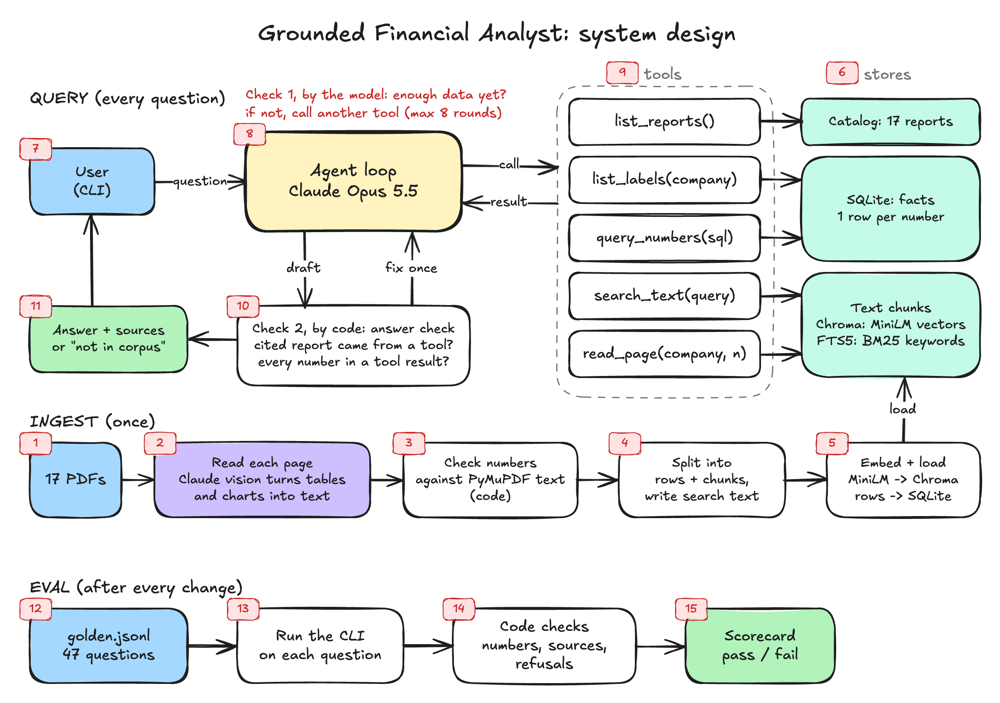

# Grounded Financial Analyst

A command-line analyst that answers questions over a folder of broker research PDFs. Every claim cites the report it came from, and when the reports don't contain the answer it says so instead of guessing.

## System design



[Open the diagram in Excalidraw](https://excalidraw.com/#json=N0_f68sYSKmxPD8SnL8Hr,MJ_5MJJG-F3U2QXaCooLZg) (use a private window if you already have a drawing open there), or load [design/system-design.excalidraw](design/system-design.excalidraw).

## Walkthrough

### Ingest (once)

1. **Read.** PyMuPDF cuts each report into pages and pulls the raw text; pages after the broker's disclosure heading are skipped. Each page goes to Claude Haiku 5.5 as a one-page PDF and comes back as structured JSON: text blocks, tables as columns and rows of values, and chart descriptions. Page 1 also yields the report card (company, sector, rating, price, target price).
2. **Check, in code.** Every value must be printed in that page's PyMuPDF text, every row must have one value per column, and four quarters must add up to the full year.
3. **Store.** Each table cell becomes one row in SQLite, with its company, row label, period, unit, actual-or-forecast flag, document and page. Text is cut into chunks of at most 160 words, embedded with all-MiniLM-L6-v2 into Chroma, and indexed for BM25 keyword search with SQLite FTS5.

**If something fails:** a page that fails the checks is read again by Haiku, then by Claude Sonnet 5.5. If it still fails it is listed as failed in the run summary. Every page result is cached on disk, so a re-run only pays for pages that are missing.

### Query (every question)

1. **Loop.** The question goes to Claude Opus 5.5 with four lookup tools:
   - `list_reports()`: the catalog of reports.
   - `list_labels(company)`: the table rows one report has.
   - `query_numbers(sql)`: one read-only `SELECT` over the SQLite numbers.
   - `search_text(query, companies)`: Chroma vector search plus FTS5 keyword search, merged, one search per company.

   Each round Claude replies with a tool call. A lookup tool means it needs more; `submit_answer` means it has enough. Code runs the lookup, adds the result to the conversation and asks again, for at most 8 rounds.
2. **Submit.** `submit_answer` takes a list of statements, each with the reports it cites. Free text is never accepted as the answer.
3. **Check, in code.** Each cited report must be one a tool returned in this run, and every number must appear in a tool result. Rounding and million/billion scaling are allowed; anything calculated has to be computed in SQL so that it shows up in a result.

**If something fails:**
- **A lookup finds nothing:** the tool returns the valid company names and a hint, so Claude retries with `list_labels` or different wording.
- **A statement fails the check:** it goes back to Claude once with the reason. What still fails is dropped.
- **Nothing survives, or the tools never found support:** the answer is "Not in the corpus".

### Eval (after every change)

`evals/golden.jsonl` holds 44 questions, each with the numbers an answer must contain, the reports it must cite, and whether it should refuse. `python -m analyst eval` runs each question through the CLI and plain Python scores it; no model grades the answers. The expected values were checked against the PDF text, and 15 questions are held out from tuning.

**If something fails:** the scorecard prints the reason per question (a missing number, a missing citation, a wrong refusal), and `--failed` re-runs only those.

### One question, end to end

**Question:** "Why did Escorts Kubota's gross margin decline in 1QFY27 despite 28% revenue growth, and what is the margin outlook?"

It needs a number from a table and a reason from the commentary, so it touches both stores.

| Round | Claude calls | What comes back | What Claude concludes |
|---|---|---|---|
| 1 | `query_numbers`: gross margin and revenue growth for Escorts Kubota, 1QFY27 | 27.2% and 28.0%, each with document and page | It has the "what", not the "why" |
| 2 | `search_text("gross margin decline reason", Escorts Kubota)` | Chunks on margins and raw-material cost inflation | It has the reason; the outlook is still missing |
| 3 | `search_text("margin outlook second half price hike", Escorts Kubota)` | The outlook commentary | Every part of the question has support |
| 4 | `submit_answer` with statements and sources | | |

The code check then passes each statement: every one cites `MotilalOswal_ESCORTS_5765676.pdf`, which the tools returned, and 27.2, 28 and 370bp all appear in tool results. A sentence such as "margins typically recover within two quarters" has nothing behind it and would be dropped.

> Gross margin fell about 370bp YoY to 27.2%, mainly because of raw-material cost inflation, even though revenue grew 28%. [MotilalOswal_ESCORTS_5765676.pdf]
> The report expects pressure to continue in the second quarter and ease in the second half as input costs cool. [MotilalOswal_ESCORTS_5765676.pdf]

This is the intended path. The real `--debug` trace replaces it once the build passes its checks.

## Run it

Needs Python 3.13, [uv](https://docs.astral.sh/uv/) and an Anthropic API key. The PDFs are not in this repository because they are the broker's copyrighted reports; put them in `docs/`.

```bash
uv venv --python 3.13 .venv
uv pip install --python .venv/bin/python -r requirements.txt
cp .env.example .env                                   # then paste your key into .env
.venv/bin/python -m analyst ingest docs/               # once; cached, so re-runs are free
.venv/bin/python -m analyst ask "What rating and target price does the broker assign to NALCO?" --debug
.venv/bin/python -m analyst eval --tier samples        # the six sample questions
.venv/bin/python -m pytest -q
```

Every command prints what it spent. A budget cap (`ANALYST_BUDGET_USD`, default 25) stops paid calls when it is reached.

## Review Q&A

<details>
<summary><b>Why not put the tables in the vector database?</b></summary>

Vector search matches meaning, and a number has no meaning to match on. Exact cells, questions that span several columns, and rankings need an exact lookup, so numbers go in SQL and only narrative goes through search.

</details>

<details>
<summary><b>How does the model know what SQL to write, and is that safe?</b></summary>

Its instructions carry the table's columns, the company names with their aliases, and the standard metric names; for any other row it calls `list_labels` first. The query runs on a read-only connection, as a single `SELECT`, capped at 200 rows.

</details>

<details>
<summary><b>How do you know the tables were read correctly?</b></summary>

Each value must be printed on its page, each row must have one value per column, and four quarters must add up to the full year. On the first report, Haiku, Sonnet and Opus all returned the same 1,026 values and every one passed the printed-on-page check.

</details>

<details>
<summary><b>Why a vision model for ingestion?</b></summary>

PDF text extraction loses which number sits under which column and gets nothing from charts. Reading the page as an image keeps the layout.

</details>

<details>
<summary><b>How does the loop know it needs another tool call, and when does it stop?</b></summary>

Each round the model sees the question and every result so far, and replies with either a lookup tool or `submit_answer`; choosing a lookup is what "needs more" means. It stops at `submit_answer` or after 8 rounds.

</details>

<details>
<summary><b>How is grounding enforced?</b></summary>

The model submits statements with sources, and code keeps a statement only if its source is a report a tool returned and every number in it appears in a tool result. Failures go back once, then are dropped.

</details>

<details>
<summary><b>When does it refuse?</b></summary>

When the company is not in the catalog, when the tools find nothing after retries, or when no statement survives the check. A half-answerable question gets the supported half plus a line saying what is missing.

</details>

<details>
<summary><b>Why these models and stores?</b></summary>

Claude Opus 5.5 runs the loop, where judgment matters; Claude Haiku 5.5 reads pages because it matched Opus on every value at about one twenty-sixth of the cost. SQLite, Chroma and MiniLM all run locally with no server, which fits a corpus of this size.

</details>

<details>
<summary><b>Why not fine-tune, and why no LangChain?</b></summary>

Knowledge baked into weights cannot be cited or reliably refused, and six sample questions are a test set, not training data. LangChain would wrap the same Claude, Chroma and SQLite calls and sit between the code and the raw tool results the check needs.

</details>

<details>
<summary><b>How would this scale to thousands of reports?</b></summary>

The stores and tools stay the same. The catalog moves out of the prompt into a lookup tool, Chroma is swapped for a hosted vector store, and ingestion is already per page and parallel.

</details>

## Limits

- A general-knowledge sentence attached to a real citation can pass the check; the refusal questions in the eval are what catch it.
- Numbers are checked against everything the tools returned in the run, not per statement, so a number from one result can vouch for a statement about another.
- A value misread into a neighbouring cell is only caught where a total exists to cross-check it.
- Chart values are described, not measured, and are marked approximate.

## Status

Build in progress. The eval scorecard and cost per question are added here when it finishes.
